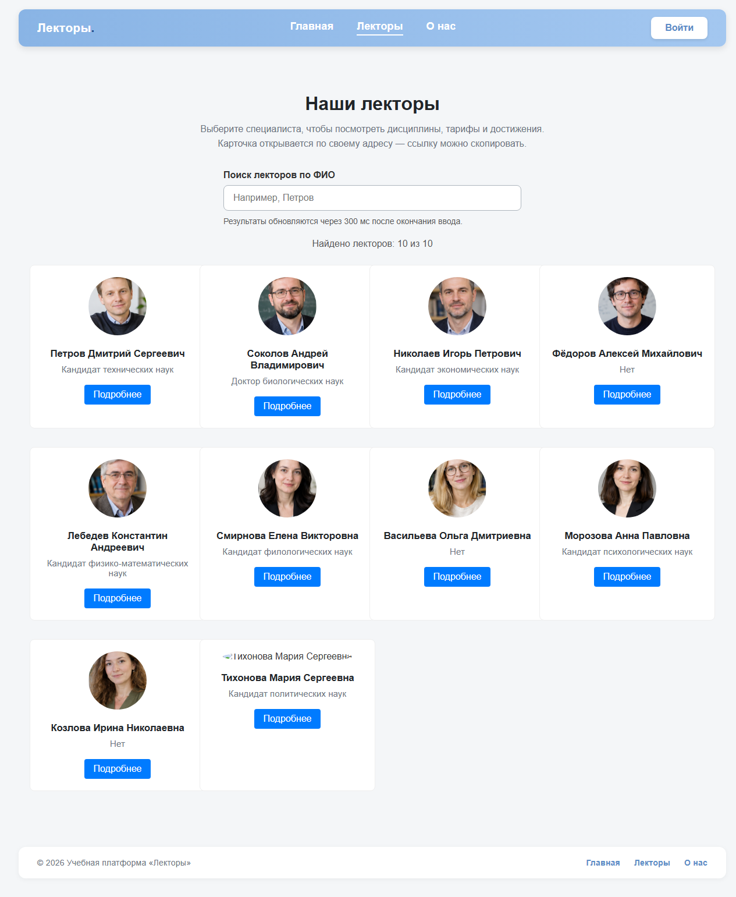

# Учебная платформа «Лекторы»

Каталог лекторов учебной платформы на React 19 + Vite. Приложение многостраничное (SPA):
у каждой страницы свой адрес, работают прямые ссылки, история браузера и страница 404.
Поиск по лекторам — с задержкой ввода (`useDebounce`, 300 мс).



## Стек

JavaScript (JSX), CSS Modules, React 19, React DOM, React Router (`react-router-dom` 7), Vite.
Тесты — Vitest + jsdom + Testing Library. Требуется Node.js 18+ и npm.

## Запуск

```bash
npm install
npm run dev
```

Откройте адрес, который выведет Vite (обычно http://localhost:5173).
Остановка — **Ctrl+C** в терминале с работающим сервером.

## Проверки и сборка

```bash
npm test          # тесты один раз (npm run test:watch — в режиме наблюдения)
npm run lint      # ESLint
npm run build     # production-сборка в dist/
npm run preview   # локальный просмотр сборки
```

`npm test` проверяет хук `useDebounce` (начальное значение, задержка 300 мс, сброс таймера при
новом вводе, смена задержки, cleanup в Strict Mode и при размонтировании) и компонент
`LecturerSearch` (единственный вызов `filter` после серии ввода, пустой результат, очистка поля,
ссылки на страницы лекторов). В тестах используются управляемые таймеры, поэтому реальных
300 мс ждать не нужно.

## Маршруты

| Адрес | Компонент | Что показывает |
| --- | --- | --- |
| `/` | `HomePage` | Баннер (Hero), краткий текст о платформе, партнёры |
| `/lecturers` | `LecturersPage` | Каталог: поиск по ФИО с задержкой 300 мс + карточки всех 10 лекторов |
| `/lecturers/:id` | `LecturerDetailPage` | Страница лектора: образование, стаж, степень, дисциплины, тарифы, достижения |
| `/about` | `AboutPage` | Блок «О нас» и «Как это работает» |
| `*` | `NotFound` | Страница 404 для любого неизвестного адреса |

Меню (`Navbar`) и подвал (`Layout`) отображаются на всех страницах. Переходы выполняются без
перезагрузки: в меню — `NavLink` (подсветка активного пункта), в карточках и кнопках — `Link`,
кнопка «Назад к списку» — `useNavigate()`, id лектора — `useParams()`.
Ссылку на конкретного лектора (`/lecturers/3`) можно скопировать и открыть в новой вкладке.

## Структура

```text
public/                  — статические файлы (favicon, иконки)
src/
  assets/                — логотипы партнёров, фоновое изображение баннера
  components/
    Layout/              — каркас приложения: меню + <main> + подвал
    Navbar/              — меню со ссылками на страницы (NavLink)
    Hero/                — баннер главной страницы
    About/               — блок «О нас» (используется на AboutPage)
    Partners/            — блок «Партнёры»
    LecturerCard/        — карточка лектора (ссылка на /lecturers/:id)
    LecturerSearch/      — поиск по ФИО с debounce, сетка карточек, CSS Module и тесты
    PersonInfo/          — шапка профиля лектора
    profile/             — блоки профиля: Disciplines, Tariffs, Achievements
  hooks/
    useDebounce.js       — отложенное значение (useState + useEffect + cleanup)
    useDebounce.test.jsx — тесты таймеров и cleanup
  data/
    lecturersData.js     — тестовые данные: 10 лекторов с фото, дисциплинами, тарифами
  pages/
    HomePage/            — /
    LecturersPage/       — /lecturers
    LecturerDetailPage/  — /lecturers/:id
    AboutPage/           — /about
    NotFound/            — 404
  App.jsx                — <Routes>: маршруты и Layout
  main.jsx               — точка входа, <BrowserRouter>
  index.css              — глобальные стили
index.html               — HTML-шаблон
vite.config.js           — настройки сборки
scripts/perf/            — скрипты замеров производительности (Lighthouse, размеры бандла)
docs/                    — отчёт по рефакторингу, скриншоты, метрики, записка по лабораторной №3
```

## Данные и поиск

Все данные лекторов лежат в `src/data/lecturersData.js` — массив из 10 объектов (`id`, `name`,
`photo`, `education`, `experience`, `degree`, `disciplines`, `tariffs`, `achievements`).
Фотографии загружаются по ссылкам Yandex Cloud из этого файла, логотипы партнёров — из `src/assets/`.
API для поиска не требуется: фильтруется локальный массив по полю `name`.

```jsx
const [query, setQuery] = useState("");
const debouncedQuery = useDebounce(query, 300);
```

Поле ввода использует `query`, а фильтрация — `debouncedQuery`. При изменении значения или
задержки эффект запускает `setTimeout`, cleanup вызывает `clearTimeout`, поэтому незавершённый
таймер отменяется при следующем вводе и при удалении компонента. Начальное значение возвращается
сразу. Это debounce: отсчёт начинается заново после каждого символа, промежуточные значения
список не фильтруют. `useMemo` не даёт фильтровать массив повторно без необходимости.

[Скриншот поиска](docs/screenshots/search-debounce.jpg).

## Что было изменено (рефакторинг навигации)

| Было (лендинг) | Стало (приложение с маршрутизацией) |
| --- | --- |
| Один компонент `App.jsx` с условным рендерингом по `useState` | `App.jsx` содержит только `<Routes>`, страницы разнесены по `src/pages/` |
| Профиль лектора «открывался» заменой содержимого, адрес не менялся | Адрес `/lecturers/:id`, страница доступна по прямой ссылке и после F5 |
| Меню — якоря `#about`, `#lecturers` | Меню — `NavLink` на маршруты, активный пункт подсвечен |
| Кнопка «Назад» браузера уводила из приложения на пустую страницу | Возврат на предыдущую страницу маршрута |
| Неизвестный адрес показывал главную | Отдельная страница 404 |
| Список лекторов был частью главной (10 фото грузились сразу) | Список — отдельная страница `/lecturers` |

Замеры «до/после» (размер бандла, Lighthouse, количество рендеров, тест навигации) и выводы —
в отчёте [docs/report-navigation-refactor.md](docs/report-navigation-refactor.md).
Записка по лабораторной №3 (debounce, вопросы автору) — [docs/lab3-variant12.md](docs/lab3-variant12.md).

## Что показать на защите

1. Меню: «Главная» → «Лекторы» → «О нас» — адрес меняется, активный пункт подсвечен, перезагрузки нет.
2. Каталог: быстро набрать «Петров» — текст появляется сразу, список фильтруется после паузы 300 мс.
3. Набрать заведомо отсутствующее имя — сообщение об отсутствии результатов; очистить — карточки вернулись.
4. Открыть карточку лектора: адрес стал `/lecturers/1`, кнопка «Назад к списку» возвращает каталог.
5. Скопировать адрес `/lecturers/3` в новую вкладку — открывается тот же лектор (deep link).
6. Нажать «Назад» браузера — возврат на каталог, а не на пустую страницу.
7. Открыть `/любой-неизвестный-адрес` — страница 404.
8. Показать `useDebounce.js` (два аргумента, `useState`, `useEffect`, таймер и cleanup) и выполнить `npm test`.
9. Открыть консоль DevTools на каталоге: видно `Рендер карточки: …` — счётчик для метрики перерисовок.

Короткий текст для демонстрации:

> Лендинг переделан в приложение с маршрутизацией на `react-router-dom`: страницы вынесены в
> `src/pages`, общий каркас — `Layout` и `Navbar`, адреса `/lecturers`, `/lecturers/:id`, `/about`,
> а неизвестные адреса отдают страницу 404. Поиск по лекторам работает через собственный хук
> `useDebounce`: символы видны сразу, а список фильтруется через 300 мс после окончания ввода,
> поэтому промежуточные значения не вызывают фильтрацию. Карточки — ссылки, поэтому навигация
> идёт через роутер, а состояние страницы сохраняется в адресе.

## Проверка производительности

Скрипты замеров находятся в `scripts/perf` (Lighthouse 12 + Puppeteer по CDP, Microsoft Edge).
Сырые результаты прогонов — в `docs/metrics/*.json`, скриншоты — в `docs/screens/`.

```bash
npm run build
cd scripts/perf
npm install
npm run serve:after        # http://127.0.0.1:4180 — сборка «после»
npm run measure            # все замеры в docs/metrics
npm run bundle             # размеры бандла (нужна эталонная сборка «до»)
npm run screens            # скриншоты страниц
```

## Деплой

Так как используется `BrowserRouter`, сервер должен отдавать `index.html` для всех путей
(SPA fallback), иначе прямая ссылка вида `/lecturers/3` даст 404 на уровне сервера.
Vite dev-сервер и `npm run preview` делают это автоматически; для nginx нужна директива
`try_files $uri /index.html;`.
