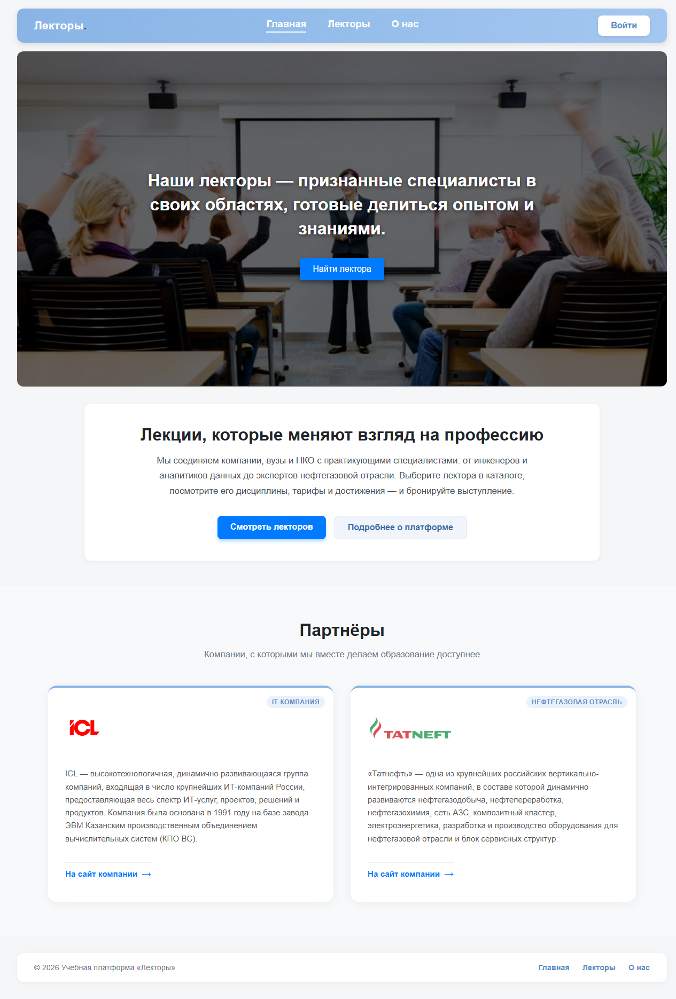

# Учебная платформа «Лекторы»

Каталог лекторов учебной платформы: React 19 + Vite. После рефакторинга навигации проект —
многостраничное приложение (SPA) с маршрутизацией на `react-router-dom`: у каждой страницы
свой адрес, работают прямые ссылки, история браузера и страница 404.



## Стек

JavaScript (JSX), CSS Modules, React 19, React DOM, React Router (`react-router-dom` 7), Vite.
Требуется Node.js 18+ и npm.

## Запуск

```bash
npm install
npm run dev
```

Откройте адрес, который выведет Vite (обычно http://localhost:5173).
Остановка — **Ctrl+C** в терминале с работающим сервером.

Сборка и просмотр production-версии:

```bash
npm run build     # сборка в dist/
npm run preview   # локальный просмотр сборки
npm run lint      # проверка ESLint
```

## Маршруты

| Адрес | Компонент | Что показывает |
| --- | --- | --- |
| `/` | `HomePage` | Баннер (Hero), краткий текст о платформе, партнёры |
| `/lecturers` | `LecturersPage` | Каталог: поиск по ФИО/степени/дисциплине + карточки всех 10 лекторов |
| `/lecturers/:id` | `LecturerDetailPage` | Страница лектора: образование, стаж, степень, дисциплины, тарифы, достижения |
| `/about` | `AboutPage` | Блок «О нас» и «Как это работает» |
| `*` | `NotFound` | Страница 404 для любого неизвестного адреса |

Меню (`Navbar`) и подвал (`Layout`) отображаются на всех страницах.
Переходы выполняются без перезагрузки страницы: в меню — `NavLink` (подсветка активного пункта),
в карточках и кнопках — `Link`, кнопка «Назад к списку» — `useNavigate()`, id лектора — `useParams()`.

## Структура

```text
public/                  — статические файлы (favicon, иконки)
src/
  assets/                — логотипы партнёров, фоновое изображение баннера
  components/
    Layout/              — каркас приложения: меню + <main> + подвал
    Navbar/              — меню со ссылками на страницы (NavLink)
    Hero/                — баннер главной страницы
    About/               — блок «О нас» (используется на AboutPage)
    Partners/            — блок «Партнёры»
    LecturerCard/        — карточка лектора в каталоге (ссылка на /lecturers/:id)
    PersonInfo/          — шапка профиля лектора
    profile/             — блоки профиля: Disciplines, Tariffs, Achievements
  data/
    lecturersData.js     — тестовые данные: 10 лекторов с фото, дисциплинами, тарифами
  pages/
    HomePage/            — /
    LecturersPage/       — /lecturers (поиск + сетка карточек)
    LecturerDetailPage/  — /lecturers/:id
    AboutPage/           — /about
    NotFound/            — 404
  App.jsx                — <Routes>: маршруты и Layout
  main.jsx               — точка входа, <BrowserRouter>
  index.css              — глобальные стили
index.html               — HTML-шаблон
vite.config.js           — настройки сборки
scripts/perf/            — скрипты замеров производительности (Lighthouse, размеры бандла)
docs/                    — отчёт по рефакторингу, скриншоты и метрики
```

## Данные

Тестовые данные лежат в `src/data/lecturersData.js` — массив из 10 объектов:

```js
{
  id: 1,
  name: "Петров Дмитрий Сергеевич",
  photo: "https://storage.yandexcloud.net/lecturers-photos/lector_men_1.png",
  education: "МФТИ, прикладная математика и информатика (2012)",
  experience: "12 лет",
  degree: "Кандидат технических наук",
  disciplines: [{ title: "...", topics: ["..."] }],
  tariffs: [{ type: "...", price: "..." }],
  achievements: ["..."],
}
```

Фотографии лекторов загружаются из Yandex Cloud по ссылкам из файла данных, логотипы партнёров
хранятся локально в `src/assets/`.

## Что изменилось в результате рефакторинга

| Было (лендинг) | Стало (приложение с маршрутизацией) |
| --- | --- |
| Один компонент `App.jsx` с условным рендерингом по `useState` | `App.jsx` содержит только `<Routes>`, страницы разнесены по `src/pages/` |
| Профиль лектора «открывался» заменой содержимого, адрес не менялся | Адрес `/lecturers/:id`, страница доступна по прямой ссылке и после F5 |
| Меню — якоря `#about`, `#lecturers` | Меню — `NavLink` на маршруты, активный пункт подсвечен |
| Кнопка «Назад» браузера уводила из приложения на пустую страницу | Возврат на предыдущую страницу маршрута |
| Неизвестный адрес показывал главную | Отдельная страница 404 |
| Список лекторов был частью главной (10 фото грузились сразу) | Список — отдельная страница `/lecturers` |

Подробные замеры «до/после» (размер бандла, Lighthouse, количество рендеров, тест навигации)
и выводы — в отчёте [docs/report-navigation-refactor.md](docs/report-navigation-refactor.md).

## Проверка производительности

Скрипты замеров находятся в `scripts/perf` (Lighthouse 12 + Puppeteer по CDP, Microsoft Edge).
Сырые результаты прогонов сохранены в `docs/metrics/*.json`, скриншоты — в `docs/screens/`.

```bash
npm run build
cd scripts/perf
npm install
npm run serve:after        # http://127.0.0.1:4180 — сборка «после»
npm run measure            # все замеры в docs/metrics
npm run bundle             # размеры бандла (нужна эталонная сборка «до»)
npm run screens            # скриншоты страниц
```

Одна из метрик — счётчик рендеров карточек. В `LecturerCard` есть строка

```js
console.log("Рендер карточки: " + lecturer.name);
```

Откройте DevTools → Console, перейдите в каталог и начните вводить текст в поиск: видно, что при
каждом изменении фильтра перерисовываются все карточки, попавшие в выборку (в dev-режиме React
StrictMode рендерит дважды, поэтому строк в консоли примерно вдвое больше).

## Деплой

Так как используется `BrowserRouter`, сервер должен отдавать `index.html` для всех путей
(SPA fallback), иначе прямая ссылка вида `/lecturers/3` даст 404 на уровне сервера.
Vite dev-сервер и `npm run preview` делают это автоматически; для nginx нужна директива
`try_files $uri /index.html;`.
