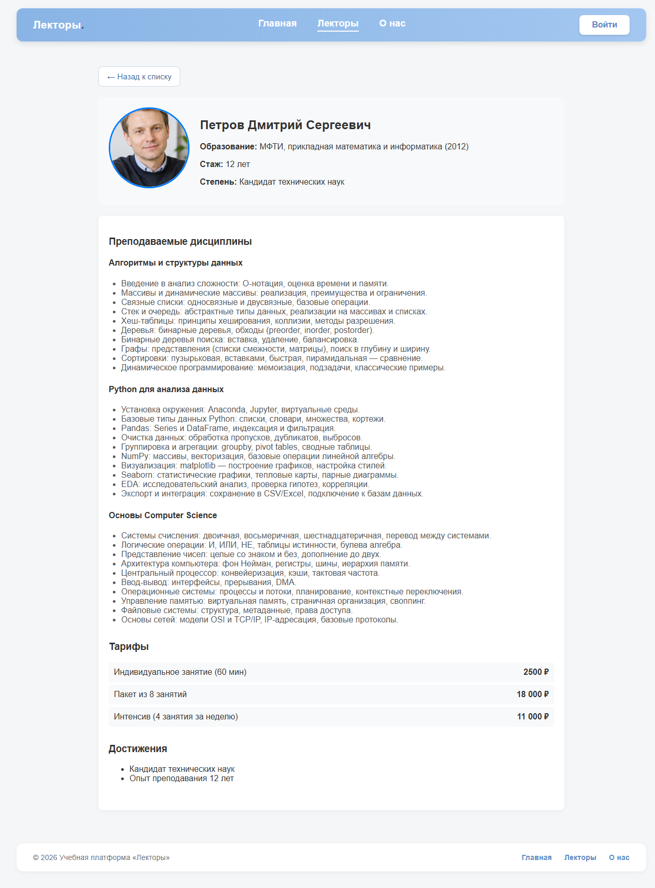
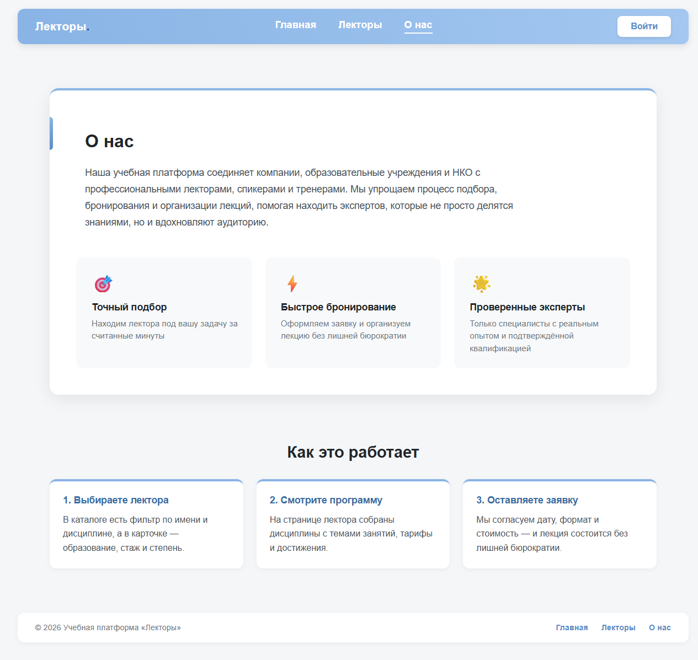
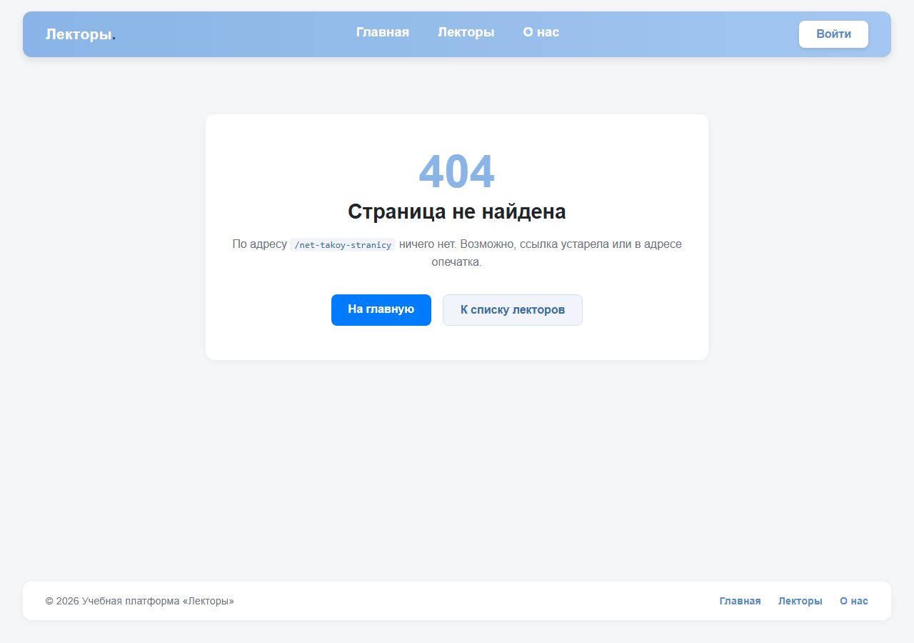
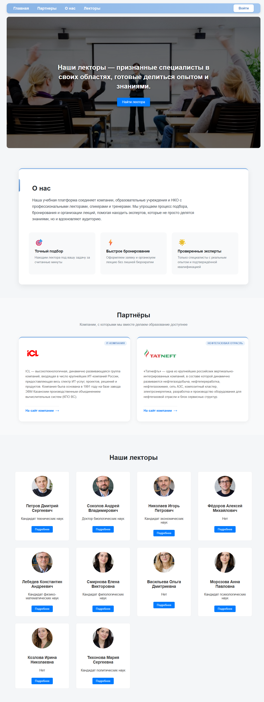

# Отчёт: рефакторинг навигации и замеры производительности

Проект: учебная платформа «Лекторы» (React 19 + Vite).
Задача: превратить одностраничный лендинг с условным рендерингом в приложение с маршрутизацией
(`react-router-dom`), затем сравнить версии «ДО» и «ПОСЛЕ» по четырём метрикам.

- Дата замеров: 19.10.2026
- Версия «ДО»: коммит `0f90c1d` (лендинг, `useState` в `App.jsx`)
- Версия «ПОСЛЕ»: текущее состояние рабочей копии
- `react-router-dom`: 7.18.4, `react`: 19.2.8, `vite`: 8.2.2, Node.js 24.20.0

---

## 1. Что сделано

### 1.1 Установка и настройка

```bash
npm install react-router-dom
```

`src/main.jsx` — приложение обёрнуто в `<BrowserRouter>`:

```jsx
createRoot(document.getElementById('root')).render(
  <StrictMode>
    <BrowserRouter>
      <App />
    </BrowserRouter>
  </StrictMode>,
);
```

### 1.2 Структура страниц

Один большой `App.jsx` разбит на файлы в `src/pages`:

| Файл | Содержимое |
| --- | --- |
| `pages/HomePage/HomePage.jsx` | Баннер `Hero`, краткий текст о платформе, блок `Partners` |
| `pages/LecturersPage/LecturersPage.jsx` | Заголовок, поиск, сетка карточек лекторов |
| `pages/LecturerDetailPage/LecturerDetailPage.jsx` | Профиль лектора: `PersonInfo` + дисциплины, тарифы, достижения |
| `pages/AboutPage/AboutPage.jsx` | Блок «О нас» + «Как это работает» |
| `pages/NotFound/NotFound.jsx` | Страница 404 |

Дополнительно:

- `components/Layout/Layout.jsx` — общий каркас: `Navbar` + `<main>` + подвал, меню на всех страницах;
- `components/Navbar/Navbar.jsx` — меню на `NavLink` (подсветка активного пункта);
- `components/profile/{Disciplines,Tariffs,Achievements}` — блоки профиля перенесены из `src/pages`
  (это не самостоятельные страницы, а части страницы лектора);
- старые `components/Header` и `App.module.css` удалены — их заменили `Navbar` и стили страниц.

### 1.3 Маршруты (`src/App.jsx`)

```jsx
function App() {
  return (
    <Layout>
      <Routes>
        <Route path="/" element={<HomePage />} />
        <Route path="/lecturers" element={<LecturersPage />} />
        <Route path="/lecturers/:id" element={<LecturerDetailPage />} />
        <Route path="/about" element={<AboutPage />} />
        <Route path="*" element={<NotFound />} />
      </Routes>
    </Layout>
  );
}
```

### 1.4 Динамический маршрут и данные

- Данные — `src/data/lecturersData.js`: массив из 10 объектов (`id`, `name`, `photo`, `education`,
  `experience`, `degree`, `disciplines`, `tariffs`, `achievements`).
- Карточка лектора целиком является ссылкой: `<Link to={`/lecturers/${lecturer.id}`}>`.
- На странице лектора id берётся из адреса и по нему ищется объект в массиве:

```jsx
const { id } = useParams();
const lecturer = lecturers.find((item) => String(item.id) === id);
```

Если лектора с таким id нет (например, `/lecturers/999`), выводится сообщение «Лектор не найден»
и кнопка возврата к списку.

### 1.5 Кнопка «Назад»

```jsx
const navigate = useNavigate();
...
<button onClick={() => navigate('/lecturers')}>← Назад к списку</button>
```

### 1.6 Эталон сборки «ДО»

Перед рефакторингом текущая версия собрана и сохранена:

- `baseline/dist-before` — чистая сборка «ДО» (использовалась для Lighthouse и размеров бандла);
- `baseline/dist-before-instrumented` — та же сборка с единственным добавленным
  `console.log("Рендер карточки: " + lecturer.name)` в `LecturerCard`, чтобы считать рендеры
  в одинаковых условиях с версией «ПОСЛЕ».

---

## 2. Методика замеров

| Параметр | Значение |
| --- | --- |
| Сборка | `vite build`, production, без source map |
| Сервер | статический сервер с SPA-fallback (`scripts/perf/serve.mjs`), локально |
| Размер бандла | сырой размер файлов + `gzip` (level 9) + `brotli` |
| Lighthouse | 12.2.1, категория Performance, mobile (412×915, DPR 2), троттлинг `simulate` |
| Браузер | Microsoft Edge (headless), подключение по CDP (Puppeteer) |
| Повторы | Lighthouse — 3 прогона, в отчёт идёт медиана; FCP по Performance API — 3 загрузки |
| Подсчёт рендеров | `console.log` в `LecturerCard`, production-сборка (без двойного рендера StrictMode) |

Скрипты замеров: `scripts/perf` (`run-all.mjs`, `bundle-size.mjs`, `capture.mjs`).
Сырые результаты: `docs/metrics/*.json` (`bundle.json`, `scenario-before.json`,
`scenario-after.json`, `lighthouse-*.json`, `fcp-samples.json`, `summary.json`).

---

## 3. Результаты

### 3.1 Размер бандла

Основной JS-файл сборки (`dist/assets/index-*.js`):

| Показатель | ДО | ПОСЛЕ | Изменение |
| --- | --- | --- | --- |
| JS, несжатый | 247 206 Б (241,4 КиБ) | 292 308 Б (285,5 КиБ) | **+45 102 Б (+18,2 %)** |
| JS, gzip | 75 803 Б (74,0 КиБ) | 90 679 Б (88,6 КиБ) | **+14 876 Б (+19,6 %)** |
| JS, brotli | 65 365 Б (63,8 КиБ) | 78 664 Б (76,8 КиБ) | +13 299 Б (+20,3 %) |
| CSS, несжатый | 7 124 Б | 12 309 Б | +5 185 Б (+72,8 %) |
| Вся сборка, gzip | 318 780 Б | 334 606 Б | +15 826 Б (+5,0 %) |

**Вывод.** Размер увеличился, так как добавилась библиотека роутера (`react-router-dom` ≈ +45 КБ
несжатого JS, +14,9 КБ в gzip). CSS вырос на 5,2 КБ из-за стилей новых страниц (меню, поиск,
страница 404, карточки). Картинки не изменились. В сжатом виде прирост JS — почти 20 %, что
для SPA с маршрутизацией ожидаемо: платить приходится за историю, deep links и 404.

### 3.2 Lighthouse (mobile, Performance)

| Метрика | ДО (главная: лендинг с каталогом) | ПОСЛЕ (главная `/`) | ПОСЛЕ (каталог `/lecturers`) |
| --- | --- | --- | --- |
| **Performance (0–100)** | **90** | **87** | **94** |
| **FCP** | **2,1 с** (2105 мс) | **2,4 с** (2404 мс) | **2,4 с** (2405 мс) |
| LCP | 3,3 с (3305 мс) | 3,6 с (3604 мс) | 2,6 с (2554 мс) |
| Speed Index | 2,1 с | 2,4 с | 2,4 с |
| TBT | 0 мс | 0 мс | 3,5 мс |
| CLS | 0 | 0 | 0 |
| Time to Interactive | 3,3 с | 3,6 с | 2,6 с |
| Вес страницы (все ресурсы) | 2 756 КиБ | 550 КиБ | 2 571 КиБ |
| Загрузка/разбор JS (bootup) | 0,05 с | 0,06 с | 0,08 с |

FCP по Performance API на локальном сервере (без троттлинга, медиана 3 загрузок):
«ДО» — 100 мс, «ПОСЛЕ» главная — 96 мс, «ПОСЛЕ» каталог — 84 мс
(в этих условиях сеть не является узким местом, разница в пределах шума).

**Вывод.** Оценка главной немного упала: **90 → 87**, FCP вырос с 2,1 до 2,4 с — ровно то, что
ожидалось от +15 КБ gzip JavaScript: на медленном мобильном соединении дополнительные ~15 КБ и
разбор кода роутера стоят около 0,3 с до первого рендера. TBT остался нулевым, CLS нулевой —
то есть интерфейс не стал «дёрганым», замедлился только старт.

Отдельно стоит страница каталога: у неё **94 балла и LCP 2,6 с против 3,3 с у версии «ДО»**.
Причина не в роутере, а в разделении страниц: с главной ушли 10 фотографий лекторов
(вес первой загрузки главной упал с 2 756 КиБ до 550 КиБ), а на каталоге самым крупным элементом
стала первая фотография, а не баннер на весь экран.

### 3.3 Подсчёт рендеров карточек (`console.log`)

Счётчик: `console.log("Рендер карточки: " + lecturer.name)` внутри `LecturerCard`.

**Версия «ДО»** (список и профиль — одно дерево, переключение по `useState`):

| Действие | Рендеров карточек | Комментарий |
| --- | --- | --- |
| Загрузка главной | 10 | все карточки на одной странице с баннером |
| Клик по карточке | 0 | список размонтируется целиком, показывается профиль |
| «Назад к списку» | 10 | список монтируется заново |

**Версия «ПОСЛЕ»**:

| Действие | Рендеров карточек | Комментарий |
| --- | --- | --- |
| Загрузка главной `/` | 0 | на главной списка нет — карточки не создаются |
| Переход в каталог по меню | 10 | первая отрисовка списка |
| Ввод «П» в поиск | 8 | в выборке осталось 8 из 10, все 8 перерисовались |
| Ввод «Пе» | 2 | в выборке 2 лектора, перерисовались оба |
| Ввод «Пет», «Петр», «Петро», «Петров» | 2 + 2 + 2 + 2 | на каждый символ — снова обе карточки |
| Очистка поиска | 0* | см. сноску: способ очистки в автотесте React не увидел |
| Клик по карточке | 0 | карточки размонтируются, открывается страница лектора |
| «Назад к списку» | 10 | список монтируется заново |

<sup>*</sup> Поле очищалось программно (`el.value = ''` + событие `input`), а React отслеживает
значение через собственный value-tracker и такое изменение игнорирует — поэтому 0 рендеров здесь
не показательны (в `docs/metrics/scenario-after.json` это поле `clearRenders`). При обычном
удалении символов с клавиатуры карточки перерисовываются так же, как при вводе.

**Итого: 6 нажатий клавиш в поиске → 18 рендеров карточек.** Перерисовываются **все карточки,
попавшие в фильтр**, а не одна изменившаяся.

**Вывод: лишние перерисовки есть.** `LecturerCard` не мемоизирован, поэтому любое изменение
состояния страницы (ввод символа в поиск) перерисовывает весь список. Видимый результат при этом
не меняется у карточек, которые остались в выборке: их `props` те же самые.

При этом сам по себе роутинг перерисовки не добавил: на главной карточек больше нет (0 рендеров
вместо 10), а клик по карточке вообще не перерисовывает список — происходит смена маршрута.

Что поможет (не реализовано, чтобы не менять условия замера): `React.memo` для `LecturerCard`.
У карточек, которые остались в выборке, объект `lecturer` тот же самый, поэтому мемоизированная
карточка пропустила бы перерисовку и вместо 18 рендеров было бы 0 (сужение выборки — это
размонтирование «лишних» карточек, а размонтирование рендером не является).

### 3.4 Визуальный тест навигации

| Проверка | ДО | ПОСЛЕ |
| --- | --- | --- |
| Пункты меню | 4 якоря (`#home`, `#partners`, `#about`, `#lecturers`), адрес не меняется | 3 маршрута: адрес меняется на `/lecturers`, `/about`, `/` |
| Подсветка активного пункта | нет | есть (`NavLink`) |
| Белый экран при переходах по меню | нет (всё на одной странице) | нет: текст в `#root` 769 / 959 / 1283 символа, ошибок в консоли 0 |
| **«Назад» браузера из профиля лектора** | **ДА, белый экран**: переход на `about:blank`, в `#root` 0 символов — пользователь выпадает из приложения | нет: возврат на `/lecturers`, список отрисован (769 символов) |
| Прямой адрес `/lecturers/3` | показывается лендинг со списком; лектор №3 не открывается | открывается страница «Николаев Игорь Петрович» |
| F5 на странице лектора | состояние теряется, показывается лендинг | страница лектора остаётся, тот же лектор |
| Несуществующий id `/lecturers/999` | такого сценария нет | сообщение «Лектор не найден» + возврат к списку |
| Неизвестный адрес | такого сценария нет | страница 404 «Страница не найдена», кнопки «На главную» / «К списку лекторов» |
| Ошибки в консоли | 0 (в одном прогоне — 3 сетевые ошибки загрузки фото с Yandex Cloud, к коду не относятся) | 0 |

**Вывод.** Белый экран в версии «ДО» был, но не при клике по меню, а в более коварном месте:
кнопка «Назад» браузера после открытия профиля уводила из приложения на пустую страницу, потому
что профиль не создавал записи в истории. В версии «ПОСЛЕ» этого нет: каждая страница — отдельный
адрес, история работает, глубокие ссылки и перезагрузка не ломают состояние.

---

## 4. Общие выводы

1. **Функционально рефакторинг удался.** Появились настоящие адреса, deep links, история браузера,
   перезагрузка без потери контекста, страница 404 и подсветка активного пункта меню. Исчезла
   «ловушка» с белым экраном при кнопке «Назад».
2. **Цена — размер бандла: +45 КБ несжатого JS (+14,9 КБ gzip, +19,6 %).** Это ожидаемая плата
   за библиотеку роутера; CSS вырос на 5,2 КБ из-за новых страниц.
3. **Производительность немного просела на старте:** Lighthouse главной 90 → 87, FCP 2,1 → 2,4 с.
   При этом вес первой загрузки главной снизился с 2 756 до 550 КиБ, а каталог лекторов набрал
   94 балла (LCP 2,6 с вместо 3,3 с) — разделение страниц дало больше, чем стоит роутер.
4. **Рендеры:** роутинг сам по себе перерисовок не добавил (клик по карточке — 0 рендеров списка,
   главная — 0 вместо 10), но `LecturerCard` не мемоизирован, поэтому поиск перерисовывает все
   карточки выборки: 18 рендеров на 6 нажатий клавиш. Это точка для следующей оптимизации.
5. **Итог:** получен правильный каркас приложения. Ухудшение FCP на 0,3 с и +15 КБ gzip — приемлемая
   плата за навигацию; при необходимости её возвращают ленивой загрузкой маршрутов.

### Что сделать дальше

- `React.memo` + `useCallback`/`useMemo` для `LecturerCard` и фильтра — убрать лишние перерисовки;
- `React.lazy` + `Suspense` по маршрутам: страница лектора с сотнями тем дисциплин — главный
  кандидат на отдельный чанк, тогда стартовый JS вернётся к размеру «ДО»;
- прокрутка наверх при смене маршрута (`ScrollToTop`): `BrowserRouter` сам позицию скролла
  не сбрасывает, а страницы стали разной длины;
- `document.title` на каждой странице (для истории и закладок);
- на боевом сервере — SPA-fallback (`try_files $uri /index.html;`), иначе прямой адрес
  `/lecturers/3` отдаст 404 от сервера.

---

## 5. Как повторить замеры

```bash
# 1. Эталон «ДО»: собрать предыдущую версию в baseline/dist-before
#    (например, git stash → npm run build → скопировать dist в baseline/dist-before → git stash pop)

# 2. Сборка «ПОСЛЕ»
npm run build

# 3. Замеры
cd scripts/perf
npm install
npm run serve:after          # http://127.0.0.1:4180  — «после»
npm run serve:before         # http://127.0.0.1:4182  — «до» (для Lighthouse)
npm run serve:before-instrumented  # http://127.0.0.1:4181 — «до» со счётчиком рендеров
npm run measure              # сценарии + FCP + Lighthouse → docs/metrics
npm run bundle               # размеры сборок
npm run screens              # скриншоты в docs/screens
```

Если браузер установлен не в `C:\Program Files (x86)\Microsoft\Edge\Application\msedge.exe`,
путь задаётся переменной окружения `BROWSER_PATH`.

---

## Приложение: скриншоты

| | |
| --- | --- |
| Главная «ПОСЛЕ»:  | Каталог «ПОСЛЕ»:  |
| Страница лектора «ПОСЛЕ»:  | «О нас»:  |
| 404:  | Главная «ДО»:  |
